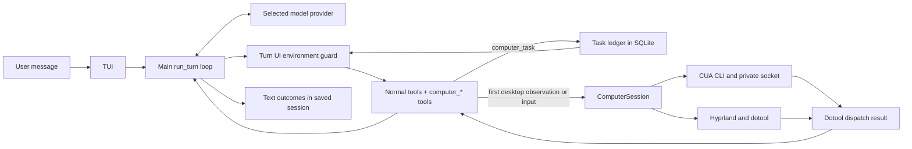

# Computer use in the main Oryn loop

This chapter records the computer-use integration in the TUI's ordinary conversation. The older `src/computer.py` and `src/providers/computer.py` planner remain as legacy code and are not used by this path. The measurements in the [earlier perception plan](18-computer-perception-plan.md) and [CUA trial](20-cua-driver-hyprland-experiment.md) motivated the design; they are not benchmarks of this integration.

## Goal and ownership

The selected Oryn model owns the user's task, chooses from the ordinary tool catalog, interprets observations, and decides when to stop. The main conversation loop owns tool rounds, budgets, cancellation, context selection, and saved history. When the TUI model supports image input, `computer_*` tools are available alongside Oryn's other tools. `computer_task` records a model-maintained task contract without starting the desktop driver. A `ComputerSession` is created only when a desktop observation or input is requested. CUA Driver observes windows, accessibility state, and screenshots, and verifies native predicates through the installed `cua-driver serve` process and `cua-driver call` over a private socket. Oryn does not use CUA's MCP transport or ComputerAgent planner. Dotool dispatches all input, including coordinate clicks and clicks derived from numbered CUA control frames, as well as keyboard input, text, right clicks, and scrolling.



The responsibilities stay in separate modules: the [TUI](../tui_app.py) adds local desktop tools to its normal catalog and supplies the task-store callbacks and lazy desktop factory; the [conversation loop](../agent/conversation_loop.py) advertises tools, enforces the declared local/remote environment, and manages history; [ComputerTaskLedger](../agent/computer_task.py) validates the model's task record; [ComputerSession](../tools/computer_session.py) validates observations and actions; the [CUA adapter](../tools/cua_driver.py) owns the CLI/socket process; and the [Codex](../providers/codex.py) and [Gemini](../providers/gemini.py) providers translate image-bearing tool results into their API formats. The [session store](../session/sqlite_store.py) keeps the task record separately from the text transcript and context summary.

## How the computer-agent parts map to Oryn

| Part | Current owner and behavior |
| --- | --- |
| Goal and progress | For work with multiple outcomes, multiple apps, or a likely need to resume, the model can create a `computer_task` record with goal, constraints, done checks, steps, facts, and evidence. One outcome, such as opening a file, can use the desktop tools without a record even when navigation takes several actions. SQLite keeps any record across chat turns and Oryn includes it in later model requests. This is model-maintained memory, not a machine verdict. |
| Action choice | The model chooses among project, browser, MCP, and `computer_*` tools in the ordinary turn. A declared `local_desktop` task cannot use remote Firecrawl `browser_*` actions in that turn; a `remote_browser` task cannot use desktop observation/input. `mixed` is explicit. |
| Desktop input | `computer_act` sends the requested input without an approval prompt after validating the current observation and target. |
| Fast execution | `computer_act` sends one input or a bounded focus/edit sequence, then captures one fresh observation whose ID can ground the next action. For longer tasks, one `computer_task(record)` call can update several steps and checks. These choices avoid model rounds spent on predictable typing, repeated observation, or bookkeeping alone. |
| Observation | Scope follows the task: `mode=desktop` for launchers and desktop overlays, `mode=active` for work inside the focused app, and `mode=windows` to locate an app already open across workspaces. Active binds the focused Hyprland window to a unique CUA window in one model call, falling back to a desktop image when needed. Desktop mode keeps its full-screen image and adds read-only active-window accessibility when CUA can safely match it. CUA provides bounded accessibility controls, screenshots, and native predicates. Dotool-only mode provides desktop screenshots. |
| Verification | CUA checks supported exact predicates; the model checks a fresh image for visual outcomes. `image=false` can skip the image after a satisfied native check. A sent input or a task-ledger claim alone does not establish task success. |
| Trace | `ComputerTrace` links tool calls, observations, input steps, checks, and resulting state when logging is enabled. |

## Decisions and reasons

| Decision | Reason | Cost or limit |
| --- | --- | --- |
| Let the selected model choose desktop tools inside the same `run_turn` loop and normal conversation as its other tools. | The model keeps prior chat context and can combine local desktop actions with web, project, terminal, browser, or MCP tools when the task calls for them. Oryn creates a `ComputerSession` only after a desktop observation or input; Dotool is invoked only for input. | Five computer tool schemas and compact guidance add context to TUI requests for image-capable models. The first desktop observation still pays CUA startup time; ordinary answers and task-record updates do not. The model still needs a round after each action call to inspect fresh state. |
| Keep the task contract in SQLite and inject only a bounded record. | Goal, constraints, steps, facts, and claimed evidence survive compaction and interrupted turns. The model can start the task record and request the first observation in one response, batch several evidence-backed updates in one record call, and skip the record entirely for a short task. | The record is model-maintained; it cannot replace a native predicate, file check, or visual assessment. Saved facts can include private UI text. |
| Bind the first successful interactive UI environment for the current turn, and honor an unfinished saved task's route on the next turn. | A local-desktop task cannot accidentally open the separate Firecrawl browser to verify local state. A remote-browser task cannot send local desktop input. A `computer_task` declaration can bind the route up front; otherwise successful first use binds it. A new task declaration can replace a saved route before UI use in the turn. An existing task can be upgraded to `mixed` with a reason when the user's task truly needs both. | The model declares mixed use; Oryn does not infer app semantics from names. Public web search/extraction and project tools remain available with either route. |
| Keep CUA on `serve` plus `call` over a private CLI socket. | That is the installed route used in the local trial. Planning and transport are separate choices, so the new task flow does not need an MCP migration. | Each CLI call has process and serialization overhead. We have not compared that overhead with MCP in this flow. |
| Use Hyprland to list workspaces and focus selected windows, CUA for exact window IDs, accessibility, screenshots, and native verification, and dotool for clicks, keys, text, and scrolls. | The accessibility tree still helps identify a control, but recent Hyprland click attempts returned an unsupported `global_input` route. Dotool already sends pointer input and keyboard/text input through the same local driver. | Dotool clicks are coordinate based and normally report `sent`; they require fresh state inspection. A numbered control without a safely mappable frame is refused. This does not establish that every app or Wayland surface will accept dotool input. |
| Prefer an exact CUA window, with a desktop route for launchers and surfaces without a usable window image. | `mode=active` selects a unique CUA window by current Hyprland process and geometry without a model round for listing. A `pid` plus `window_id` keeps later observations and native predicates tied to that window. Desktop mode can add read-only labels from the safely matched active window. | Active mode returns a desktop image if no unique CUA match exists. Other exact-window reads require supplied IDs. Desktop input rejects a changed active-window stamp. The desktop labels add up to two bounded CUA calls and may add latency; no live speed comparison has been made. These checks cannot prove page content stayed still. |
| Keep one latest screen observation and one latest window list. | Task records and skill loading preserve both in model context. Reads replace only the same kind. Window lookup does not erase the screen or its one-use action ID; screen reads preserve the latest window-list ID. | Retained images add model input and remain past captures. Live target checks still apply. An action or native wait invalidates both old IDs and returns fresh state. Turn exit removes details from saved history; closing the desktop session clears its references. |
| Consume one `observation_id` for one input or a bounded focus/edit sequence, then return a fresh observation. | The ID and numbered-control mapping stop reuse of a stale snapshot. A grounded sequence of up to five inputs can save model rounds for predictable steps; five is a ceiling, and a screen transition starts a new segment. The fixed same-window text patterns `type → Enter` and `Ctrl+L → type → optional Enter` use one Dotool process. | Oryn cannot see in-window content changes between steps. The one-process patterns do not recheck focus between keystrokes, so no earlier input may switch or close the target window. Other sequences keep per-step target checks. A `sent` effect is not proof that the UI changed. |
| Prefer a ready launcher search field for named-app launches. | Typing the requested app name and submitting in one bounded sequence avoids targeting a small launcher icon by pixels. The returned screenshot is the verification point. | This applies when the search field is visibly ready. An uncertain launcher state still needs a fresh observation and a grounded choice. |
| Supply basic desktop guidance with the computer tools; keep specialized skills available. | Routine turns omit the bundled `computer-cua` reference guide from `load_skill` discovery because the built-in instructions already cover the workflow. The existing catalog still offers project/domain skills and specialized desktop guides. | Naming `computer-cua` in the current user message makes it available. A same-named guide from another project or the user's skill directory remains discoverable. |
| Interpret action effects as delivery evidence and recover only from fresh state. | The Driver and Hermes guidance both emphasize reading structured effects, checking state before retrying uncertain input, and treating escalation hints as signals rather than automatic commands. This addresses duplicate input after `sent` results and repeated malformed calls. | Dotool reports that the input command completed, not that the UI changed. The model must inspect the fresh observation before retrying. |
| Use CUA `verify_state` for exact native conditions; use `min_age_ms` for visual loading. | A native predicate can wait locally, with cancellation, for up to ten seconds without repeatedly asking the model to interpret screenshots. For a visual-only condition, model thinking time counts toward the requested image age, followed by one capture. | Native verification covers only supported window and element predicates. `unknown` stays unknown. A visual wait gives a fresh image, not an automatic proof of success. |
| Skip a screenshot only after a satisfied exact native check when requested. | `image=false` on `computer_act` or `computer_wait` avoids image capture and upload when the predicate itself is enough for the next decision. | A failed or unknown check still captures an image. A tree-only result cannot ground new pixel coordinates. |
| Keep local desktop control distinct from native `browser_*` tools while making both available in normal chat. | Oryn's native browser tools use a remote Firecrawl session; `computer_*` acts on the local desktop. Their descriptions tell the model which environment each controls. A search result cannot prove what is visible locally. | Having both sets in one catalog makes the environment distinction important; model selection errors remain possible and need evaluation. |
| Dispatch computer input from the current observation. | The user can supervise the running task without approving each click or key. Oryn still checks the single-use observation ID, window identity, control frame, and coordinate bounds before dispatch. | The model can make a wrong choice and execute it immediately; fresh observations and the task ledger help it inspect the result but do not prevent every mistake. |

The old planner, CUA ComputerAgent, and a separate browser or site-specific polling layer are not part of this TUI path. The current tools are designed for general desktop tasks, with exact native checks where available and fresh visual evidence elsewhere. The [ComputerSession source](../tools/computer_session.py) is authoritative for supported actions and predicate fields.

## One interaction

1. For multiple outcomes, multiple apps, or a task likely to need resuming, the model calls `computer_task(operation="start", ...)` with a goal, constraints, done checks, steps, and UI environment. A single outcome can start with the desktop observation instead. The record is saved per chat. Step names and done-check names must be distinct within their lists. One `record` call can update several steps and checks with separate evidence inside each `updates` item, using `kind` plus the exact `name` from the task record instead of an index. For example, `{ "kind": "step", "name": "Open Blender", "status": "verified", "evidence": "Blender viewport is visible" }`. The older flat `step_index` and `check_index` fields remain accepted for compatibility but are not advertised. If a provider supplies top-level `evidence` with a batch, the ledger ignores it; evidence for verified items must stay inside those items. Each result lists remaining step and check names, even if the model supplied a different `next_step`. A complete finish requires all done checks to be verified; unused planned steps may remain when the goal was reached by another route. When final evidence is omitted, it reuses the last verified done check's evidence. These are model claims that must match actual tool results. The model can request the first observation in the same response as the task record.
2. If the desired app is focused, `computer_observe({"mode":"active"})` matches the Hyprland active window to one CUA window by PID and bounds, then returns its tree and image; when matching is unavailable, it returns a desktop image. For another named app, `mode="windows"` lists Hyprland clients across workspaces, sorted by workspace, and enriches unique matches with CUA `window_id`. Its `observation_id` and a listed `window_index` ground one `computer_act` `focus_window` action. Focus checks that the window still matches, switches to it through Hyprland, and returns a fresh active-window image and tree when available. The model can also use `mode="window"` with a uniquely matched `pid` and `window_id` to inspect that exact CUA window. Mode-specific shapes include `{"mode":"active"}`, `{"mode":"windows"}`, `{"mode":"window","pid":811,"window_id":42}`, and `{"mode":"desktop"}`. The wrapper discards irrelevant optional fields on windows and desktop calls instead of forwarding them to CUA, and treats an empty observation ID plus an all-zero region as absent zoom placeholders; the model is still instructed to omit irrelevant fields. The schema intentionally does not enforce the window-only PID/ID constraints globally: providers may validate irrelevant default fields before the wrapper can discard them. The window handler enforces `pid > 0` and `window_id >= 0` when that mode is selected. A new listing replaces the previous window list but preserves the latest screen observation; a screen read replaces the previous screen but preserves the latest list. Loading a skill preserves both. Desktop mode is available for launchers and surfaces without an exact window target; when CUA matches the active window, it also adds read-only labels from that window to the desktop screenshot result. There is no automatic one-second switch period.
3. A window read asks CUA for at most 500 accessibility elements and a native-size screenshot. When a document element exists, Oryn sends its controls before window chrome within the 60-control model limit, and starts the tree excerpt at the document. A later `image=false` read can skip the image. If Wayland cannot prove a window screenshot, Oryn matches and focuses the exact Hyprland window, refreshes its tree, then captures a desktop image. The result names the image coordinate scope. If the match is ambiguous, observation fails safely and the model can choose another route. A desktop overview also uses the monitor's native pixel dimensions. For a small target, `computer_observe({"mode":"desktop","observation_id":"<latest overview ID>","region":{"x":400,"y":150,"width":300,"height":250}})` captures a fresh native-resolution crop. The region is located in overview pixels; the returned image and its new ID accept crop-local click pixels, which Oryn maps to the monitor. A crop action returns a new full desktop observation. Zoom requires the latest full desktop ID and unchanged active-window stamp. If focus changes during the crop, Oryn returns a fresh full desktop image with `zoom_aborted` instead of a stale crop. A crop never supplies actionable accessibility controls.
4. The model calls `computer_act` with one `action` array containing 1–5 input objects and the current `observation_id`. The runtime also accepts one action object as a shorthand, while the advertised schema keeps the array form. A one-item array sends one input; 2–5 items form a sequence within one screen segment. Every action requires a short `expected_result` describing the visible or native state the returned observation should show. A windows-list observation grounds one `focus_window` action. If the model requests another input from that list, Oryn sends no input and returns a fresh desktop observation for the next decision. A sequence may contain keys alone, may include at most one single-line `type` step, and may start with one click. Pressing Enter can only be its final step. The fixed text patterns `type → Enter` and `Ctrl+L → type → optional Enter` run as one Dotool process only from active/exact-window observations; the result reports `dispatch_mode:"single_stream"`. They do not check focus between keystrokes, so an earlier input must not switch or close the target window. Other sequences report `dispatch_mode:"step_checked"` and retain per-step target checks. Both old screen and window-list IDs are invalidated before dispatch; the requested snapshot supplies that action’s target. An expired or used ID sends no input and returns a fresh observation; an absent numbered control, unmappable frame, or point outside the current image/display is rejected without input. Hyprland focuses listed windows; Dotool receives every click, key, text, right-click, and scroll. For `click_element`, Oryn maps the current control frame to its center in the selected monitor's screenshot coordinate frame before Dotool dispatch. CUA is never called to click. Common key aliases are canonicalized before Dotool receives them, such as `escape`→`esc`, `return`→`enter`, and Super aliases in chords→`super`.
5. Oryn returns the Dotool outcome or per-step outcomes and a fresh observation in that same tool result. A `step_checked` sequence stops if a step is refused or uncertain, or if the target window changes before a later step. A `single_stream` sequence is sent as one ordered input stream and reports each step as sent only after the stream command completes. Earlier inputs may already have happened if a stream errors, so inspect the fresh state before repairing. Its text includes `screenshot_included:true/false`; when true, the matching screenshot is attached to that result. The returned `observation_id` is valid for the next action; a separate `computer_observe` is only useful if the UI is still loading, the image or scope is insufficient, or the result is ambiguous. After a window-scoped action, Oryn observes the desktop when the focused app's PID changed; otherwise it observes the exact window. If the exact window can no longer be observed, Oryn tries a fresh desktop image and reports the window-observation error. A desktop capture retries once if focus changes during capture. A `windows` listing has no screenshot. The model inspects the image and status before choosing another action. `sent` means the input command completed; it says nothing about screenshot presence or the application's response. A preflight refusal such as `active_window_changed` or `element_frame_unavailable` means the requested input was not sent. Unknown, timed-out, and interrupted actions are never replayed automatically.
6. If the next state is an exact native predicate, `computer_act.wait_for` or `computer_wait` calls CUA `verify_state` for that window, up to ten seconds, with cancellation. `unknown` remains unknown. `image=false` on those calls returns a tree-only observation after a satisfied check, or an image if the check fails or is uncertain. For loading visible only in the image, `computer_observe.min_age_ms` delays only until the previous image has the requested age, counting model thinking time, and then captures once. If a shortcut returns an image of a transition or the old window, the model can take a bounded desktop observation, then inspect it before dependent input; a windows listing is not a visual wait result.
7. `computer_act` sends input in the same call after validating the current observation and target, then returns a fresh observation. `computer_ask_user` gathers missing task information without ending the turn and, when there was a current observation, returns a fresh one with the answer. It is not an action approval step.

Pixel clicks compare a small target area against a fresh capture after the window-focus check and before Dotool input. If the area changed, Oryn waits up to one second for that area to settle, refuses the old click, and returns a new observation. A single desktop key action also checks the area that changed between its before and after images; if it is still moving, Oryn refreshes the returned image. These checks use the current image scope and do not depend on an app name. Animated content under a pointer can cause a valid click to be refused, so the model should inspect the returned image and choose a semantic control or fresh point. Accessibility-only clicks have no image patch to compare.

For an exact-window image with matching pixel geometry on one unscaled, unrotated monitor, Oryn can capture just the target area with `grim` and verify the same window ID through CUA. A different window is refused; when the small capture or its identity cannot be established, Oryn falls back to the full-window check. Other image scopes keep their existing capture path.

For a short task, each `computer_act` returns the input outcome and a fresh observation. The model checks that state before continuing or finishing. Further `computer_observe` and `computer_wait` calls remain available when the UI is loading or ambiguous; no fixed observation cap applies. A repeated action pattern produces a soft `computer_progress` hint, without comparing screenshots or claiming task success. The durable `computer_task` record remains separate for longer work.

For “turn on dark mode in Settings,” the model can skip `computer_task` and check the resulting screen after acting. For longer work that may be interrupted, a record can begin with:

```json
{
  "operation": "start",
  "goal": "Update the appearance setting and document the result",
  "environment": "local_desktop",
  "constraints": [],
  "done_checks": ["Settings shows dark mode selected", "The result is documented"],
  "steps": ["Select dark mode and check the result", "Document the result"]
}
```

The model can request the first `computer_observe` in that same response. After the setting changes, it can record what the fresh observation or native predicate showed. When a later result supports several planned items, one record call accepts separate evidence per item:

```json
{
  "operation": "record",
  "updates": [
    {"kind": "step", "name": "Select dark mode and check the result", "status": "verified", "evidence": "The returned Settings view shows dark mode selected"},
    {"kind": "check", "name": "Settings shows dark mode selected", "status": "verified", "evidence": "The returned Settings view shows dark mode selected"}
  ]
}
```

Each update uses the exact name from the saved task. Both steps and done checks accept `pending`, `working`, `verified`, and `blocked`; `verified` and `blocked` need evidence. One batch can cover up to eight steps and six checks; duplicate names or invalid statuses reject the entire call before saving. The older flat record fields still work for existing callers. If the next input is already grounded in the last result, the model can put `record` before that input in the same response. Once the final result has been observed, it can put `record` and `finish` in one response. These calls must use evidence from an earlier tool result, never from an action in the same response. The record preserves progress if the chat turn is interrupted; the observed UI state remains the evidence for success.

When the current observation already determines a safe sequence of up to five inputs within one screen segment, the model should prefer one sequence over separate model turns. The action that submits or starts navigation is the final action; Oryn then returns one fresh observation before the next decision. Do not batch opening an unseen menu, overlay, or app with actions that depend on its new screen; inspect it first. The `Ctrl+L → type → Enter` example is a fixed same-window pattern and is sent in one Dotool process after a fresh focus check when grounded in an active/exact-window observation. Other chains retain checks between inputs. For example, after observing the local browser with `mode="active"` and receiving a window-scoped result:

```json
{
  "observation_id": "current-observation-id",
  "action": [
    {"type": "key", "key": "ctrl+l"},
    {"type": "type", "text": "https://example.com"},
    {"type": "key", "key": "enter"}
  ],
  "expected_result": "The browser starts opening example.com"
}
```

The tool checks and focuses the current target once, sends the three ordered inputs through one Dotool process, returns an outcome for each step, and captures one new image. In the recorded Monkeytype run, the old path launched Dotool three times for this chain, each taking about 0.7–0.8 seconds; this path removes two of those launches. A loading page may still need a later bounded observation. The chain removes two model decisions and two intermediate screenshots; it does not eliminate model response time. An uncertain click or a changed UI should use a single action followed by observation.

## Latency guidance

Oryn's tool loop is sequential where the next UI action depends on the latest screen. Avoiding an unnecessary model round usually matters more than saving a few milliseconds inside a task-record write. A short task starts with an observation and answers directly from its action result when that state proves the goal. The computer instructions and task-tool description put this path first. For example, switching away from Output Devices and returning needs one other tab click and the return click, without a checklist or separate completion read. A long task should batch evidence-backed updates and avoid standalone `working` records. `computer_act` already returns the next screenshot and accessibility result, so a second observation should answer a new question such as whether a loading page has settled. Use a native `wait_for` predicate when the exact expected state is exposed; choose `min_age_ms` for visible asynchronous changes rather than as a routine pause.

A single controlled comparison on 2026-11-19 used the live `gpt-6-luna` provider with default reasoning/tier and simulated accessibility-only Pavucontrol tabs. Both versions received the same task, initial Output Devices selection, and five computer tools. The baseline was commit `96c2ec3`; the updated loop and guidance were tested together.

| Simulated run | Model requests | Task-record calls | Observations | Input calls | Requested tab clicks | Elapsed |
| --- | ---: | ---: | ---: | ---: | --- | ---: |
| Baseline | 11 | 4 | 2 | 4 | Playback → Output Devices | 35.96 s |
| Updated | 5 | 0 | 1 | 3 | Playback → Output Devices | 13.52 s |

Both finished with Output Devices selected. This is one trial per version, with synthetic controls and no real capture, Dotool input, or full TUI tool catalog. It does not establish a real-desktop speedup or isolate the prompt change from the retention fix. Regression tests separately reproduce the old loss of screen details after notes, verify image-free and image-bearing retention, replacement by newer observations, and cleanup on final answer, provider failure, cancellation, or budget exit. Optional task records and necessary follow-up reads remain available; the guidance cannot guarantee that every model chooses the shortest route.

This follows the [OpenAI computer-use loop](https://developers.openai.com/api/docs/guides/tools-computer-use), which returns a screen after a short action group, and [CUA Driver's observation contract](https://github.com/trycua/cua/blob/main/docs/content/docs/cua-driver/concepts/how-cua-driver-works.mdx), which provides a window tree and screenshot together. Neither source implies that every extra read is wasteful: loading, missing accessibility, and uncertain results still need a fresh check. The [OpenAI integration guide](https://developers.openai.com/api/docs/guides/tools-computer-use-integration) recommends comparing task success, elapsed time, model turns, and recovery rather than judging speed by one tool call.

## Basic computer guidance and skill discovery

`run_turn` already injects `COMPUTER_INSTRUCTIONS` whenever computer tools are available. Previously it also advertised the bundled `computer-cua` guide. In the real Brave run `computer-20261119T114504Z-106284.jsonl`, the model loaded that overlapping guide before listing windows: five model requests and 23.329 seconds overall. The skill tool itself took about 30 ms; the model response choosing it took 4.506 seconds. That does not mean removing it guarantees a 4.506-second saving, since the next response still needs to choose an action.

The catalog now omits only this repository's bundled guide when computer instructions are supplied and the latest user message does not name `computer-cua` (case insensitive, with name boundaries). Explicit naming, including `$computer-cua`, preserves the normal load-and-audit path. Without computer tools the guide remains available. Guides from other projects or user skill directories are not hidden by name alone, and `caelestia-hyprland` and `computer-dotool` remain available. This is catalog selection, not a new skill system or a prohibition on loading instructions.

The mandatory instructions also retain the guide's practical details about ready launcher search, grounded URLs, attached-image scope, and correcting malformed calls. The reference file remains available for manual reading and explicit requests. Observation retention, input validation, task storage, and Dotool timing are unchanged.

Validation passed all **259 regression tests**, including catalog selection, explicit loading and diagnostics, specialized-guide availability, and same-named project/user alternatives. A controlled `gpt-6-luna` comparison used default provider settings, the three project skills, computer tools, and a synthetic accessibility-only browser. Both versions received the same request to open a new Brave tab, visit `https://docs.python.org`, report its fixture title, and leave it open. No real browser, screenshots, or Dotool input were used.

| Version | Trial times | Model requests | Successful objectives | General guide loads |
| --- | --- | --- | --- | --- |
| Baseline `7b95682` | 13.28 s, 17.88 s | 5, 6 | 2/2 | 0 |
| Updated | 11.57 s, 14.38 s | 5, 5 | 2/2 | 0 |

Trials ran baseline → updated → updated → baseline. The baseline already skipped the guide in both trials; its sixth request was an additional observation. This checks continued task correctness but does **not** establish a speedup caused by removing the guide. The deterministic regression proves its routine catalog omission; real TUI performance and other model routing choices still need user-run observation. The temporary comparison script and output are `/tmp/oryn_skill_comparison.py` and `/tmp/oryn_skill_comparison.jsonl` on the development machine.

### Hyprland guide selection

The next real Brave log, `computer-20261119T131426Z-156780.jsonl`, contains two attempts. The first (`95c4c5743e22`, `gpt-5.6-luna`) loaded `caelestia-hyprland` before any desktop observation, then was cancelled after 6.516 seconds. Its completed model response took 3.258 seconds and the load itself took 30 ms; the cancelled second request accounts for additional time. The continuation (`0a586a9ffe02`, `gpt-6-luna`) used four model requests in 20.211 seconds: list windows, focus Brave, send Ctrl+T/type URL/Enter, and answer. It used no Caelestia-specific key binding. The model changed and the guide was already in conversation history, so this is not an isolated speed comparison.

The profile previously advertised itself for local desktop tasks generally. Its description and opening paragraph now scope it to Caelestia launcher, workspace, or custom desktop shortcuts. They clarify that ordinary in-app shortcuts and `focus_window` from a window list are already covered by the built-in tools. The skill remains in the catalog and can still be explicitly requested. Its shortcut mappings, loader, tool schemas, and execution checks are unchanged. This adjusts the model's selection guidance; it does not prohibit a load or guarantee a particular model route.

Validation passed the 24 skill-loading and conversation-loop regression tests. A catalog check confirmed that the 175-character description reaches `load_skill`, the guide remains in its enum, and exact-name loading still returns its complete instructions. The change introduces no runtime logic, so the unchanged full suite was not rerun for this wording-only update.

Eight controlled model trials used default provider settings, the three project skills, computer tools, and the synthetic accessibility-only Brave fixture. Each model received one baseline and one updated browser task, followed by updated implicit and explicit shortcut questions. There was no real desktop input.

| Task | `gpt-5.6-luna` | `gpt-6-luna` |
| --- | --- | --- |
| Browser, baseline profile | 5 model requests, no guide load, correct final state | 5 requests, no guide load, correct final state |
| Browser, updated profile | 4 requests, no guide load, correct final state | 5 requests, no guide load, correct final state |
| Ask for the user's custom Brave shortcut | Loaded guide, answered Super+W, 2 requests | Loaded guide, answered Super+W, 3 requests, one extra observation |
| Explicitly load guide and ask for launcher key | Loaded guide, answered Super, 2 requests | Loaded guide, answered Super, 2 requests |

All eight trials selected the intended guide route and returned the expected task result. Seven also met the stricter efficiency criterion; the `gpt-6-luna` implicit shortcut question made an unnecessary `computer_observe` call. That remains a separate routing concern. Neither baseline browser trial loaded the guide, so these runs do not establish a reduction in redundant loading or a speedup attributable to the wording. The temporary test script and results are `/tmp/oryn-hyprland-guide/comparison.py` and `/tmp/oryn-hyprland-guide/comparison.jsonl` on the development machine.

## Observation lifetime validation

The bounded retention change keeps one screen snapshot (tree and optional image) and one window-list snapshot in `ComputerSession`; `current` remains the latest produced result for trace/capture bookkeeping. `ComputerResult.observation_scope` lets the conversation loop retain the corresponding two detailed tool results without parsing their text. Task notes, skill loading, and observations of the other kind preserve these results. An action, native wait, or stale-ID recovery clears both old runtime references; closing the desktop session clears any remaining references. Detailed results are removed from stored conversation history on turn exit, including failure or cancellation.

Regression checks cover independent replacement in both directions, image-free replacement of an older screen image, skill loading with both source orders, a launcher key after a window lookup, focus from a retained window list after a screen read, changed-focus refusal without input, native-wait invalidation, one-use IDs, and exit cleanup. These checks do not require shared-desktop input.

Live launch attempts on 2026-11-19 are not a reliable performance comparison. The first overlapped the user's desktop work. A later attempt sent launcher input but exhausted a 14-round test budget without verifying the requested tab state; a screenshot showed **No results** for the literal launcher query `pavucontrol`. Shared-desktop input testing was stopped. Neither run establishes a successful app-closed path or proves that retaining context cures the model's repeated reads. The earlier successful app-open run also predates this change. Keep the launcher naming issue and model route choice separate from the verified observation-lifetime behavior.

A subsequent live run (`computer-20261119T112340Z-94262.jsonl`, trace `f271998d510c`) launched **Volume Control** and confirmed Output Devices selected in 27.301 seconds with seven model requests, three observation calls, one skill load, and two action calls containing three keyboard inputs. It used screen ID `bfe8046f75ad` after loading the Hyprland skill, without rereading the screen merely for that skill load, and encountered no refusals or tool errors. There were no tab clicks, so this validates retention through skill loading and app launching, but not the requested switch-away-and-back step. The launcher query differed from the earlier attempts; this single run is not an isolated speed comparison. The final regression suite passed all 256 tests.

## Action outcomes and recovery

The tool's `effect` reports what the input route could establish. It does not by itself prove the user's requested outcome.

| Effect or result | Interpretation and next step |
| --- | --- |
| `confirmed` | The driver has readback evidence for the input. Check the task postcondition before reporting completion. |
| `partial` | Only part of the input may have landed. Inspect fresh state and repair only what remains. |
| `sent` | The input command completed without proving its UI effect. It says nothing about screenshot presence. Inspect the attached fresh image when `screenshot_included:true` (or request a screenshot if false) before considering another action; dotool reports this normally. |
| `suspected_noop` | The driver has evidence that the action probably did not change the target. Inspect state and choose a reasoned next step. |
| `refused` | The selected route did not send the requested input. For Oryn preflight reasons such as `active_window_changed`, `target_focus_failed`, or `element_frame_unavailable`, the requested click/key was not dispatched; use the fresh observation returned with the result before choosing another action. An escalation hint is not permission or an automatic retry. CUA is not a click fallback. |
| `unknown`, timeout, or cancellation | Input may or may not have occurred. Never replay automatically; observe first. |

## Failure diagnosis from the Fern desktop run

The original run exposed an evidence and tool-boundary error. After the desktop shortcut, Oryn's `computer_act` path returned a fresh desktop observation with its screenshot attached. The assistant's later self-report said it had not taken a screenshot and inferred failure from the input status plus the window stamp, but the tool flow did return an image. That image could support “Brave is not visible in this frame yet”; neither the input status nor an unchanged stamp proves the launch failed permanently. The new `screenshot_included` field makes image availability explicit alongside the image itself.

The assistant then used `browser_open` and `browser_click`. Those are native Firecrawl tools operating in a remote browser session, not local Brave or CUA. A malformed/stale element reference and a guessed URL led to the wrong video. With the integrated catalog, the model sees both remote and local browser capabilities; the tool descriptions and desktop guidance call out which environment each one controls. Only a fresh `computer_*` observation can verify what is visible on the local screen. If launching an app appears delayed, take a fresh desktop observation and inspect it before choosing another action; further reads remain available if loading or ambiguity persists. Do not guess a URL or repeat a shortcut to create a wait.

The staged Brave smoke run found two more interface gaps. First, the model sent `leftmeta+w`; dotool warned that `leftmeta` is not a chord modifier, and Oryn reported `unknown`. The current key normalizer converts that chord to `super+w` before dispatch and preserves `leftmeta` as a standalone key. It also converts common aliases such as `escape` to `esc` and `return` to `enter`. Second, after `super+w` returned an image scoped to the original `foot` window, the model called `computer_observe(mode="windows", min_age_ms=1000)`. That call waits then lists window metadata; it does not capture pixels. The excerpt is truncated before the full list, so it does not establish whether Brave appeared there. The updated guidance directs app-launch settling to a full-desktop screenshot before claiming the app is visibly open.

Computer traces now record an MCP status snapshot at task start and the duration of each MCP tool-directory lookup before a model request. The snapshot includes aggregate lifecycle counts and per-server state/connect duration, but no credentials, URLs, or error text. Together, these timings show whether MCP startup or directory assembly accounts for time before a model request, or whether the delay happened elsewhere.

For invalid arguments, the model should use the error's correction guidance once and should not repeat unchanged arguments. The adapter currently projects mode-specific observation arguments before calling CUA, which prevents irrelevant `pid`, `window_id`, or `image` defaults from reaching the backend on windows/desktop calls. If a corrected call fails again or no exposed route can complete the task, stop and report the limitation.

The external guidance we adapted is the [Cua Driver workflow](https://github.com/trycua/cua/blob/main/libs/cua-driver/rust/Skills/cua-driver/WORKFLOW.md), [Hermes computer-use prompt guidance at commit `762bc75`](https://github.com/NousResearch/hermes-agent/blob/762bc75/agent/prompt_builder.py#L3254-L3540), and [Hermes computer-use skill](https://github.com/NousResearch/hermes-agent/blob/main/skills/autonomous-ai-agents/computer-use/SKILL.md). Their action vocabularies and recovery rungs are specific to their wrappers; Oryn keeps its own `computer_*` schema and only adopts the general snapshot, evidence, and recovery principles.

## Example: wait for an app setting

Suppose the user asks, “Turn on dark mode in Settings, and tell me when it is on.” These IDs and labels are illustrative; the real app must expose the corresponding control before the model can use it.

1. `computer_observe({"mode":"windows"})` lists the candidate windows. The model selects Settings by its returned `pid` and `window_id`, then calls `computer_observe({"mode":"window","pid":811,"window_id":42})`.
2. If the fresh tree already reports the “Dark mode” check box selected, the model can stop. If it reports an unselected numbered control, say `[7]`, the model sends one action tied to that observation:

   ```json
   {
     "observation_id": "the-current-observation-id",
     "action": [{"type": "click_element", "element_index": 7}],
     "expected_result": "Settings shows dark mode selected",
     "wait_for": {
       "element": {
         "selector": {"role": "check box", "label_contains": "Dark mode"},
         "selected": true
       }
     },
     "wait_timeout_ms": 5000
   }
   ```

3. `computer_act` sends that one click through Dotool, asks CUA to verify the predicate if the action was not refused or unknown, and returns the verification result plus a fresh observation. A verified selected state supports completion. If verification is `unknown` or the control disappeared, the model examines the new tree and image, then chooses another observation, a visual check, or a clarification. It does not repeat the click merely because the predicate was unknown.
4. If the app exposes only a visual toggle or spinner, the model uses the desktop or window screenshot and may call `computer_observe({"mode":"window","pid":811,"window_id":42,"min_age_ms":2000})`. Oryn waits only for any remaining part of the two seconds since the prior capture, takes one new image, and lets the model assess it. There is no repeated screenshot loop hidden inside that call.

This example shows the conditional boundary: Dotool sends the click, native facts can be checked by CUA, and visual facts still require the model to interpret a new image. `expected_result` describes what the model should compare against; it is not automatically evaluated. The structured `wait_for` predicate performs the native check. This example does not assume every Settings app has an accessible “Dark mode” check box.

## Boundaries and cost

In the TUI, computer schemas are included in ordinary turns only when the selected provider confirms image input. The normal tools remain available and the model chooses whether to call `computer_*`. The old `/computer <task>` spelling is accepted as a compatibility alias, not a separate tool route; its `--dry-run` form still previews the first proposed input. Oryn creates a `ComputerSession` for desktop observations, actions, or waits; task-record updates and an initial clarification do not start CUA. Dotool runs only when an input action is sent. The selected provider sends a screenshot as an image part of the corresponding tool result. Task-record and skill-loading responses preserve one latest screen observation and one latest window list in context, with their source IDs. A screen observation includes its screenshot, if present, and matching controls; a newer tree-only screen read replaces the older image too. Each new read retires only the prior result of its own kind, including within one model response. An action, wait, clarification, other tool, or final answer retires both detailed context entries. Desktop input and waits also invalidate both previous runtime IDs, then provide fresh state. The action and verification outcomes and tool-call pairing remain in history. Turn exit always removes detailed screen data. Retention does not refresh a capture or bypass target checks. Normal context compaction and the normal turn budget still apply. The bounded tree, optional tree-only read, one action call per observation, and one final capture after a wait limit unnecessary calls; native-size screenshots use more image bytes.

For dotool input to an exact window, Oryn matches CUA's pid and bounds to one Hyprland client, focuses it if required, and checks that focus changed. For desktop input, it rejects a changed active-window stamp. This does not prove arbitrary page content stayed unchanged during model thinking; the model still needs fresh observations and must treat tool feedback as evidence, not completion.

The dotool-only environment override retains Hyprland workspace listing and focus plus desktop screenshots and actions, but has no CUA window directory or `verify_state`. Native CUA window screenshots can remain unavailable on Wayland. The task record and route guard are general; they do not attach a local browser DOM or discover app-specific scripting APIs automatically. A high-frequency game controller with HUD interpretation is not part of this desktop loop. A live Obsidian run exercised window listing and `focus_window` for a tiled window on the current workspace; switching to a window on another workspace remains unobserved. The [earlier CUA trial](20-cua-driver-hyprland-experiment.md) describes the routes tested before this reform. The local baseline measured a 5.83-second median model response across 249 saved responses and a 673-millisecond median screenshot capture across five captures; those different samples explain why we tried to avoid redundant model and image calls, but they cannot predict this flow's task latency or cost.

The [proposed execution redesign](24-computer-execution-redesign.md) describes the next experiment. Conditional execution across newly observed UI states is future work; the current 1–5 input sequences above do not implement it.
